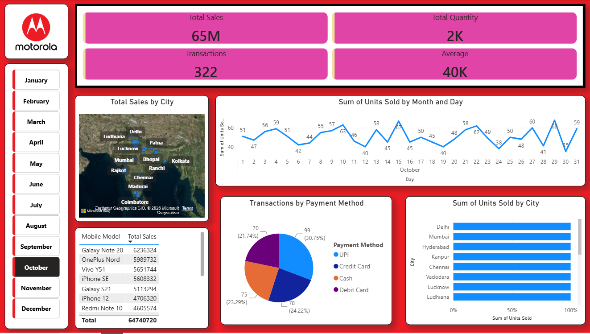

# 📱 Motorola Sales Analysis Dashboard (Power BI)

An interactive Power BI dashboard that analyses Motorola mobile sales across cities, models, payment methods and time.

## Dashboard Preview

## Objective
To understand sales performance, find top-selling mobile models and cities, and see how customers pay.

## Tools Used
- Power BI Desktop
- DAX (measures)
- Data cleaning and modelling in Power BI

## KPIs
- Total Sales
- Total Quantity
- Number of Transactions
- Average Sales

## Visuals in the Dashboard
- Sales by city (map)
- Total sales by mobile model (table)
- Transactions by payment method (pie chart)
- Units sold over time (line chart)
- Units sold by city (100% stacked bar chart)
- Month slicer to filter the whole dashboard

## Key Insights
- Sales Performance: Analyzed total sales, total quantity sold, number of transactions, and average sales to evaluate overall business performance.
- City-Wise Sales Analysis: Compared sales across different cities to understand geographical sales distribution.
- Monthly Sales Trends: Analyzed monthly trends in units sold to understand changes in sales performance over time.
- Mobile Model Performance: Compared total sales across different Motorola mobile models to evaluate product performance.
- Payment Method Analysis: Examined transactions by payment method to understand customer payment preferences.
- Geographical Sales Distribution: Used a map visualization to explore sales distribution across cities.
- Sales and Quantity Analysis: Compared units sold across cities to identify differences in product demand.

## Dataset
Mobile sales data containing date, city, mobile model, units sold, payment method and sales amount.

## Files
- `motorola_sales_dashboard.pbix` - Power BI dashboard file
- `dashboard.png` - screenshot of the dashboard

## Author
**Paresh Subhash Sawant**
B.Com Graduate | Aspiring Data Analyst
Email: sawantparesh64@gmail.com
